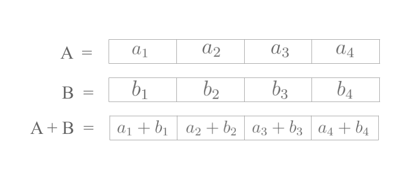
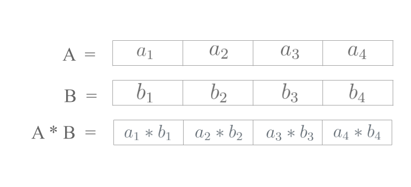
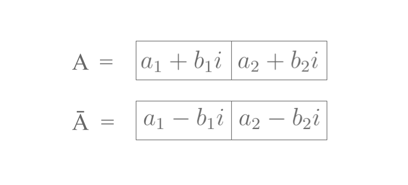
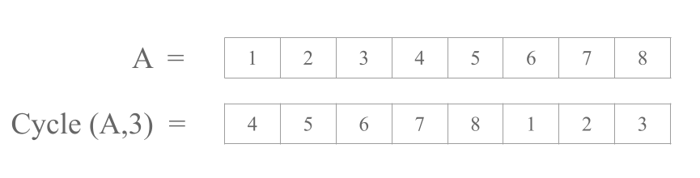

## Setup

Our simplified CKKS setup is as follows:

1.  Let $N$ be a power of $2$ (concrete default: $N = 2^{16}$).

2.  The users provide ciphertext $\mathsf{ct}$ with each such ciphertext encrypting $N/2$ complex numbers. In other words, $$\mathsf{ct} = \mathtt{enc}(z_1, \ldots, z_{N/2}).$$

3.  As a default bound on the numbers involved, suppose the complex numbers have form\
    $z_j = x_j + iy_j$ where $x_j, y_j \in \mathbb{R}$. We can assume the $x_j$ and $y_j$ are bounded above by $10^6$ and have precision $10^{-10}$.

As $\mathsf{ct}$ is just encrypting some data, we are allowed to make copies of $\mathsf{ct}$, save them, etc. **NOTE:** We are allowed to self-encrypt data which will be useful in further

Any further operations on $\mathsf{ct}$ are considered difficult by default, and we must instead "build" them from a limited set of basic "moves" given by the encryption scheme. These moves are as follows:

-   **addition**: given ciphertext $\mathsf{ct}_1 = \mathtt{enc}(r_*)$, $\mathsf{ct}_2 = \mathtt{enc}(s_*)$, (where each $r_j, s_j \in \mathbb{C}$) we can generate a ciphertext $$\mathsf{ct'} = \mathtt{enc}(r_1 + s_1, r_2 + s_2, \cdots, r_{N/2} + s_{N/2}).$$

{fig-alt="Addition Example" fig-align="center" width="591"}

-   (element-wise) **multiplication**: given ciphertext $\mathsf{ct}_1 = \mathtt{enc}(r_*)$, $\mathsf{ct}_2 = \mathtt{enc}(s_*)$, we can generate a ciphertext $$\mathsf{ct'} = \mathtt{enc}(r_1 s_1, r_2 s_2, \cdots, r_{N/2} s_{N/2}).$$

{fig-alt="Multiplication Example" fig-align="center" width="591"}

-   **complex conjugation**: given ciphertext $\mathsf{ct} = \mathtt{enc}(z_*)$, we can generate a ciphertext $$\mathsf{ct}' = \mathtt{enc}(\overline{z_1}, \ldots, \overline{z_{N/2}}).$$ Recall that $\overline{x+iy} = x-iy$ for real numbers $x$ and $y$.

{fig-alt="Conjugation_Example" fig-align="center" width="591"}

-   **cycle**: given a ciphertext $\mathsf{ct} = \mathtt{enc}(z_1, \ldots, z_{N/2})$, we can, for any $k \in \{1, 2, \dots, N/2\}$, create a ciphertext $$\mathsf{ct}' = \mathtt{enc}(z_k, \ldots, z_{N/2}, z_1, \ldots, z_{k-1}).$$

{fig-align="center" width="591"}

This is not an exhaustive list of moves and part of open research is determining what other techniques are possible in CKKS. For the scope of our doc, we will assume this is the complete list of moves. We note two practical things that we will mostly ignore for the rest of our work:

1.  We can assume these moves are fast but not negligible. Think of all of these moves as taking place on the order of milliseconds with addition being faster at microseconds.
2.  In our scheme, numbers get worse in two ways as we compute on them: they accumulate noise (for instance floating point arithmetic accumulates error) and they also become potentially easier to decrypt by an adversary.

::: {.callout-tip icon="false" title="**Remarks**"}
1.  For brevity, we will often write as shorthand $\mathtt{enc}(z_*)$ or suppress the $\mathtt{enc}$ and discuss the vectors directly.

2.  For many use cases (especially order-dependent notions like median, sign, etc.), we can assume that we are only dealing with real numbers (formally, the imaginary coordinate is 0). Since this is often clear from context, we omit disclaimers for clarity.

3.  We are allowed to self-encrypt data, which is an important step in operating on our ciphertext directly.
:::