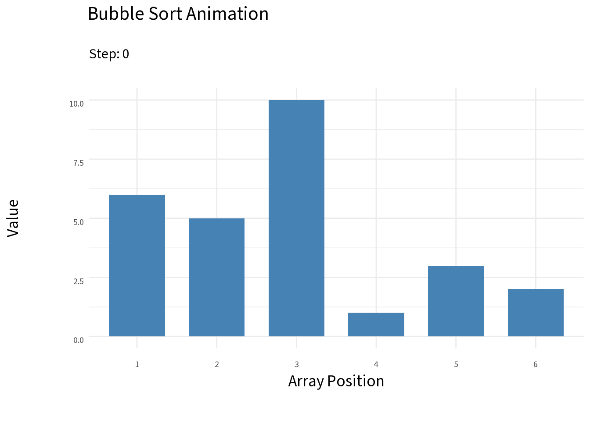

### Bubble Sort

As a proof-of-concept, we choose to use **bubble sort**[^bubble-1] as a starting point for sorting.\
Despite being a well-known "slow" sorting algorithm, it is a good candidate for FHE prototyping because its operations are local: only swaps, with no dynamic memory allocation (which e.g. quicksort would need).
Each of its steps is one operation on a pair of positions, so we define that operation first.

[^bubble-1]: **Bubble sort** available from https://en.wikipedia.org/wiki/Bubble_sort

### PairSort {#sec-pairsort}

Given an $n$-length vector $x$, the following move will return an $n$-length vector $y$ that is equal to $x$ in every coordinate except possibly $x_i$ and $x_j$.\
We call this move $\mathtt{PairSort}_{i,j}(x)$:

> Compare $x_i, x_j$ (typically, $i+1 = j$).\
> (1) If $x_i < x_j$, then $y = x$ with no swapping performed.\
> (2) If $x_i > x_j$, then $y$ has $x_i$ and $x_j$ swapped.

PairSort is known elsewhere as a compare-and-swap or comparator. To perform it without branching in FHE, we use a polynomial approximation of the sign function.

For two encrypted values $x_i$ and $x_j$, let
$$s = \mathtt{sign}(x_i-x_j),$$
where the sign function is approximated by a polynomial and returns approximately $1$ when $x_i \geq x_j$ and $0$ when $x_i < x_j$. This replaces an ordinary conditional such as "if $x_i \geq x_j$, swap" with arithmetic selection:

$$
\begin{aligned}
y_i &= s x_j + (1-s)x_i,\\
y_j &= s x_i + (1-s)x_j.
\end{aligned}
$$

This gives $y_i$ the smaller value between $\{x_i, x_j\}$ and $y_j$ the larger value.

::: {style="text-align: center;"}
For $(x_i,x_j)$, the outputs are computed to be $(y_i, y_j)$.

$(x_i,x_j)=(7,3)$, $s\approx1$ so the output is $(3,7)$.

$(x_i,x_j)=(3,7)$, $s\approx0$ so they remain $(3,7)$.
:::

The same operations run in both cases; no branch depends on encrypted data. The approximation is reliable only on its intended input range and away from the transition near equality.

We treat PairSort as an abstraction that we assume we have.
The construction above is only a suggested implementation, since its approximate comparison runs into floating point issues.
The sorts in these chapters are therefore proofs of concept that show what a reliable PairSort would make possible.
We expect this to be an implementation problem, not a fundamental barrier.

It's a bit tricky to actually implement this with vector-wide operations without being wasteful.\
Here is one draft:

1.  Construct constant $1$-hot vectors $c_1 = (1, 0, \ldots, 0)$, $c_2 = (0, 1, 0, \ldots)$, ... Let $x = (x_1, \ldots, x_n)$.
2.  For a given $i, j$, compute $$m' = (c_i - c_j) * (x_i, x_i, \ldots, x_i) + (c_j - c_i) * (x_j, x_j, \ldots, x_j).$$ This will have a $0$ everywhere, except $m'_i = x_i - x_j$ and $m'_j = x_j - x_i.$
3.  Now multiply $m = (c_i - c_j) * m'$. This will also have a $0$ everywhere, except $m_i = m_j = x_i - x_j$.
4.  Let $s = -\mathtt{sign}(m)*m'$. Here,
    -   $s_i$ will be $x_j - x_i$ if $x_i > x_j$, 0 otherwise.
    -   $s_j$ will be $x_i - x_j$ if $x_i > x_j$, 0 otherwise.
    -   all other elements are 0.
5.  Compute $y = x + s$. If $x_i < x_j$ then $s_k = 0$ everywhere, so $y = x$. If $x_i > x_j$ then $y_i = x_i + (x_j - x_i) = x_j$, and $y_j = x_j + (x_i-x_j) = x_i$. In other words, the result flips $x_i$ and $x_j$ if $x_i > x_j$, meaning the smaller element goes to $x_i$ and the larger element goes to $x_j$.

The resulting $y$ is $\mathtt{PairSort}_{i,j}(x)$.
Note this is fully FHE legal and involves no branching.

### The Bubble Sort Algorithm

Bubble sort passes through a given vector, applying PairSort to each neighboring pair.
Each pass moves the largest remaining element to the end of the unsorted part, which takes $O(n^2)$ repeated pairwise element comparisons to finish the sort:

1.  Perform $\mathtt{PairSort}_{1,2}(x)$, ..., $\mathtt{PairSort}_{n-1,n}(x)$. These $n-1$ moves ensure the maximum element is now at $x_n$.
2.  Perform $\mathtt{PairSort}_{1,2}(x)$, ..., $\mathtt{PairSort}_{n-2,n-1}(x)$. These $n-2$ moves ensure the second-largest element is now at $x_{n-1}$.
3.  ...

```{r}
#| echo: false
#| warning: false
#| message: false
#| fig-align: center
#| fig-alt: "A gif animation of a simple bubble sort being done on 6 bar barplot"
#| cache: true

if (knitr::is_html_output()) {
library(ggplot2)
library(gganimate)
library(dplyr)
library(showtext)
library(sysfonts)


set.seed(203)
# Set an initial vector with 6 bars
initial_vector <- sample(1:10, 6)

# Set bubble sort as a function
bubble <- function(arr) {
  n <- length(arr)
  swap <- TRUE
  
  # FIX: Change 'step_count' to 'step' so it matches the rest of your code
  step <- 0 
  
  # Set up a dataframe that holds all previous images together
  history <- data.frame()
  
  # Start from step 0 and initialize it
  history <- rbind(history, data.frame(
    Step = step,
    Index = 1:n,
    Value = arr,
    Status = "Normal"
  ))
  
  # While the swap is true, keep incrementing
  while (swap) {
    swap <- FALSE
    
    for (i in 1:(n - 1)) {
      step <- step + 1
      
      # Generate image during comparison
      frame_data <- data.frame(
        Step = step,
        Index = 1:n,
        Value = arr,
        Status = ifelse(1:n %in% c(i, i + 1), "Comparing", "Normal")
      )
      # Save it to history
      history <- rbind(history, frame_data)
      
      # If we detect a swap
      if (arr[i] > arr[i + 1]) {
        # Swap the elements
        temp <- arr[i]
        arr[i] <- arr[i + 1]
        arr[i + 1] <- temp
        swap <- TRUE
      }
    }
  }
  
  # Check the finished state
  step <- step + 1
  history <- rbind(history, data.frame(
    Step = step,
    Index = 1:n,
    Value = arr,
    Status = "Finished"
  ))
  
  return(history)
}

# Run the history tracker
sorting_data <- bubble(initial_vector)

#add font to match quarto's font
font_add_google("Source Sans 3", family = "source-sans", db_cache = FALSE)
showtext_auto()

# 3. Create the ggplot object
p <- ggplot(sorting_data, aes(x = factor(Index), y = Value, fill = Status)) +
  geom_bar(stat = "identity", width = 0.7) +
  scale_fill_manual(values = c("Normal" = "steelblue", "Comparing" = "red", "Finished" = "forestgreen")) +
  labs(
    title = "Bubble Sort Animation",
    subtitle = "Step: {closest_state}",
    x = "Array Position", 
    y = "Value"
  ) +
  theme_minimal() +
  theme(legend.position = "none", plot.title = element_text(size = 32, face = "bold"),text = element_text(family = "source-sans"), axis.title = element_text(size = 28), plot.subtitle = element_text(size = 24), axis.text = element_text(size = 15))

# 4. Animate across the 'Step' variable
anim <- p + transition_states(Step, transition_length = 1, state_length = 2)

# 5. Render and save the file to your working directory
gif1 <- animate(anim, nframes = max(sorting_data$Step) * 2, fps = 3, renderer = gifski_renderer("sorting_visualizer.gif"))


} else {
}
```

$O(n^2)$ total comparisons (with $O(n)$ per pass) will entirely sort $x$.
However, this gets fairly costly and noisy due to the multiplications in the approximated comparisons.

@fig-bubble-network shows the complete schedule for eight inputs. Each horizontal line is a vector position and each arrow is one PairSort, with the larger value moving toward the arrowhead.^[Each layer (a column of arrows) is one batched sign evaluation, a single SIMD step, so the number of layers is the number of sequential comparison steps. Every layer holds a single PairSort, so this network needs 28 sequential comparison steps for 8 inputs.]

```{r}
#| label: fig-bubble-network
#| echo: false
#| warning: false
#| message: false
#| fig-align: center
#| fig-width: 9
#| fig-height: 4.6
#| dev.args: !expr list(bg = "transparent")
#| fig-cap: "The bubble sort network for eight inputs, with 7 passes, 28 layers, and 28 PairSorts. Only one PairSort runs in each layer."
#| fig-alt: "A sorting network with eight horizontal lines, one per vector position, read from left to right. Vertical arrows mark PairSort operations between neighboring positions, one per layer, grouped into seven numbered passes. Each pass moves from the top of the vector downward and stops one position earlier than the pass before it, forming a staircase. Pass 1 has seven arrows and pass 7 has one. Each arrow points to the higher position, which receives the larger value."

library(ggplot2)

n <- 8

# Each row is one PairSort: the larger value moves to `to`.
network <- do.call(rbind, lapply(1:(n - 1), function(p) {
  data.frame(pass = p, from = 1:(n - p), to = 2:(n - p + 1))
}))
network$layer <- seq_len(nrow(network))

# A small gap separates the passes.
network$x <- network$layer + (network$pass - 1) * 0.7

passes <- data.frame(
  pass = 1:(n - 1),
  xmin = tapply(network$x, network$pass, min) - 0.45,
  xmax = tapply(network$x, network$pass, max) + 0.45
)

neutral <- "grey50"
line_start <- min(network$x) - 0.9
line_end <- max(network$x) + 0.9

ggplot() +
  geom_rect(
    data = passes,
    aes(xmin = xmin, xmax = xmax, ymin = 0.55, ymax = n + 0.45),
    fill = neutral, alpha = 0.12
  ) +
  geom_text(
    data = passes,
    aes(x = (xmin + xmax) / 2, y = 0.2, label = pass),
    color = neutral, size = 5, fontface = "bold"
  ) +
  annotate(
    "text",
    x = line_start - 0.6, y = 0.2, label = "Pass",
    color = neutral, size = 5, fontface = "bold"
  ) +
  annotate(
    "segment",
    x = line_start, xend = line_end, y = 1:n, yend = 1:n,
    color = neutral, linewidth = 0.4
  ) +
  annotate(
    "text",
    x = line_start - 0.6, y = 1:n, label = 1:n,
    color = neutral, size = 5, fontface = "bold"
  ) +
  geom_segment(
    data = network,
    aes(x = x, xend = x, y = from, yend = to),
    color = neutral, linewidth = 0.9,
    arrow = arrow(length = unit(0.1, "inches"), type = "closed")
  ) +
  geom_point(
    data = network,
    aes(x = x, y = from),
    color = neutral, size = 2
  ) +
  scale_y_reverse() +
  coord_cartesian(clip = "off") +
  theme_void() +
  theme(
    plot.background = element_rect(fill = "transparent", color = NA),
    panel.background = element_rect(fill = "transparent", color = NA)
  )
```

